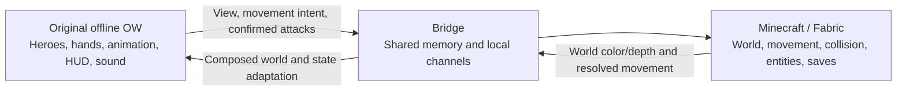

<div align="center">
  
  <h1>Overwatch × Minecraft</h1>
  <p><strong>Original Overwatch heroes in a real Minecraft world.</strong></p>
  <p><a href="LICENSE"></a></p>
  <p><a href="README.md">简体中文</a> · English · <a href="docs/BUILDING.md">Build guide</a></p>
</div>

A non-commercial fan research project using the **2016 offline Overwatch beta 0.8.0.24919** and **Minecraft 1.21.1 / Fabric**. Not affiliated with or endorsed by Blizzard Entertainment, Mojang, or Microsoft. Not for sale or commercial use; this statement does not grant redistribution rights to game files.

Two real processes run together. Original OW renders heroes, first-person weapons, animations, HUD, and native sound. Minecraft owns the world, movement, collision, entities, dimensions, and saves. The player uses the OW window.

## Demo


**Full trailer: link pending.** This silent GIF contains 12 real gameplay cuts, lasts 8.4 seconds, and is approximately 6.26 MB. The full video is excluded from this repository. [Still frames and provenance](docs/media/README.md).

## Features and scope

- Twelve assault / defense heroes: Genji, McCree, Pharah, Reaper, Soldier: 76, Tracer, Bastion, Hanzo, Junkrat, Mei, Torbjörn, and Widowmaker. Several abilities remain incomplete.
- Original hero presentation and local voice assets; confirmed native attack events feed actual MC world effects.
- Current source implements **F5 hero training NPC summons and survival / invulnerability switching**. MC training NPCs do not implement complete OW hero AI.
- F6 flight; F7 world settings; F8 portals; F9 mob summons; F10 Boss destinations; F11 experimental resource refill.
- Actual Twilight Forest dimension footage, optional Iris / MakeUp shaders, and a unified launcher with normal save / shutdown controls.

### Implemented in development; coming in the next package

- **F5 summons / survival:** implemented in development source; the existing `1.0.0` package lacks the implementation classes.
- **Mei ice wall fix:** completed in development and planned for the next integrated package; the trailer has no updated shot.

The next package must be rebuilt and checked before its download is published. This source-snapshot check did not launch either game.

## Download

<!-- DOWNLOAD_LINKS -->
> **OWMC-1.0.0 integrated package (~5 GB): download link pending.**
>
> Mirror: pending · SHA256 file: pending
>
> Only a local test package exists. Version alignment, publication audit, and distribution scope remain to be confirmed.
<!-- /DOWNLOAD_LINKS -->

Game clients, private models, voices, textures, saves, toolchains, and full packages are excluded from the source repository. A clone does not provide a complete playable environment.

## Quick start

Once a complete package is available:

1. Extract the entire ZIP to a writable folder on NTFS / exFAT; the archive exceeds FAT32's 4 GB file limit.
2. Double-click **`ow x mc 启动器.exe`** and wait. With the package defaults, the launcher loads the background MC world and the original hero picker automatically.
3. Select a hero and play. Click **“结束游戏”** in the launcher to save and stop normally.

If “打开即启动” (start on opening) was disabled, click “开始游戏” on the home screen. Requirements: Windows 10 2004+ / Windows 11 x64, working Direct3D 11 and Minecraft-compatible OpenGL drivers, at least 8 GB RAM (16 GB recommended), and about 20 GB free disk space. A complete package supplies its runtimes; players do not need development tools. Cross-machine and sustained-play acceptance are still incomplete.

Unsigned executables and in-process adapters may be blocked by security software. Verify the source, SHA256, and the actual detection before acting. See the [Chinese player guide](docs/PLAYER-README.md) for runtime dependencies, logs, backups, and targeted recovery steps.

## Controls

| Keys | Action |
| --- | --- |
| WASD / mouse | Move / look |
| Space / Ctrl | Jump; ascend / descend while flying |
| Left / right mouse | Primary / secondary attack, where available |
| R / V | Reload / melee, depending on hero |
| Shift / E / Q | Native abilities / ultimate, subject to native state and charge |
| H | Original hero picker |
| F5 | Hero summons / survival menu; current source, pending package update |
| F6 / F7 | Flight / world settings |
| F8 / F9 | Portal / mob summon menus |
| F10 / F11 | Boss destinations / experimental resource refill |

Use number keys or the numeric keypad as shown by each menu. The OW window must have focus. Availability depends on the current mode, world, and installed mods; F11 does not restore every resource type.

## Architecture



## Known issues

The trailer's copied-package session did not certify McCree's Deadeye visuals, Reaper's Death Blossom start, Junkrat's drivable / detonated RIP-Tire, or Torbjörn's primary / secondary gunfire, hammer swings, turret repair, and upgrades. Junkrat's death bombs had counter changes but insufficient visual evidence. These are scoped observations, not claims that every version always fails. Mei's ice wall is fixed in development and will be included in the next package.

Full hero kits, complete Boss encounters, other machines, sustained performance, and display-mode compatibility remain incompletely verified. This documentation task did not start a game or repeat runtime acceptance.

## Development

Use Windows x64, **Python 3.13 in `.venv`**, JDK 21, Gradle 8.10.2, and MinGW-w64. Prepare excluded game files and tools locally.

```powershell
.\tools\setup_environment.ps1
.\.venv\Scripts\python.exe tools/check_environment.py
.\tools\build_guest.ps1 -Tasks build,check
.\tools\build_live_passthrough.ps1
.\.venv\Scripts\python.exe bridge/test_contract.py
```

`guest/` contains the Fabric implementation; `native-host/` contains native adapters; `bridge/` holds Python protocols; `tools/` contains build and launch tools. See [BUILDING.md](docs/BUILDING.md) for all six modules and the public-scope pack command. Its `--public` flag excludes private/client inputs; it is not publication or licensing approval.

## Credits

- [Universal Modder](https://github.com/rehan-remade/universal-modder) and its [mashup-mods skill](https://github.com/rehan-remade/universal-modder/tree/main/skills/mashup-mods), MIT: route and tooling references.
- [Prometheus](https://github.com/saturn-xvi/prometheus), AGPL-3.0: offline-client research and structural references; its license remains separate.
- [Fabric Loader](https://github.com/FabricMC/fabric-loader) / [Fabric API](https://github.com/FabricMC/fabric-api), Apache-2.0; [Twilight Forest Fabric](https://github.com/TeamTwilight/twilightforest-fabric), LGPL-2.1-or-later; [owo-lib](https://github.com/wisp-forest/owo-lib), MIT.
- [Sodium](https://github.com/CaffeineMC/sodium), PolyForm Shield 1.0.0 for the local 0.8.13 build; [Iris](https://github.com/IrisShaders/Iris), LGPL-3.0-only for the local build; [MakeUp Ultra Fast](https://github.com/javiergcim/MakeUpUltraFast), LGPL-3.0.
- [Dear ImGui](https://github.com/ocornut/imgui), MIT, used upstream by Prometheus; [JNA](https://github.com/java-native-access/jna), Apache-2.0 or LGPL-2.1-or-later; [Mixin](https://github.com/SpongePowered/Mixin), MIT; and the Python / Java ecosystem.

Developed with assistance from Claude / Codex. [Third-party details and sources](docs/THIRD-PARTY.md).

## License and assets

Project-owned code is licensed under the [MIT License](LICENSE), copyright **2026 RPQ123**. Third-party and derived works retain their own terms; MIT does not cover Prometheus AGPL code, game assets, or bundled license texts. See [THIRD_PARTY_NOTICES.md](THIRD_PARTY_NOTICES.md).

OW / Minecraft clients, models, voices, and textures are excluded and are not covered by the project MIT license. `docs/media/` contains only compressed demonstration images and a short GIF. Game and trademark rights remain with their respective owners; full-package distribution requires a separate scope decision.
