

  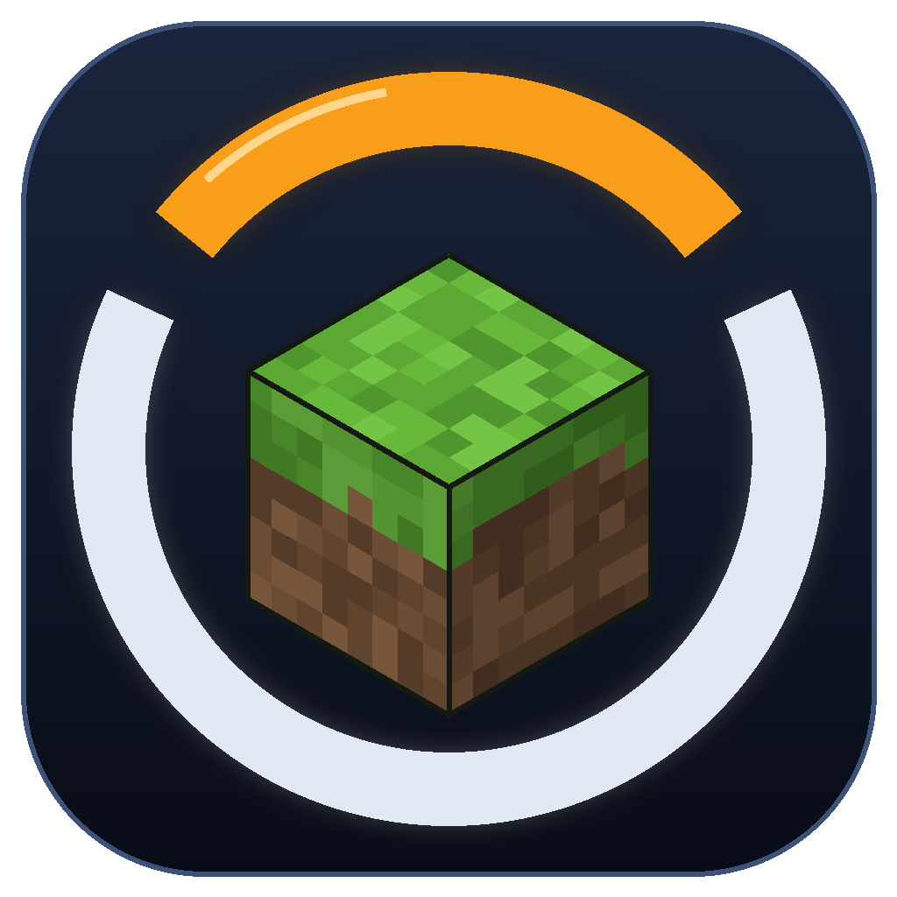
  <h1>Overwatch × Minecraft</h1>
  
<strong>Original Overwatch heroes in a real Minecraft world.</strong>

  

    <kbd>v1.0.0</kbd>
    <kbd>Windows x64</kbd>
    <kbd>MC 1.21.1 Fabric</kbd>
    <kbd>OW 0.8 Beta</kbd>
    <a href="LICENSE"><kbd>MIT</kbd></a>
    <kbd>14 heroes</kbd>
  

  

    <a href="#demo">▶ Demo</a> ·
    <a href="#download">Download</a> ·
    <a href="#quick-start">Quick start</a> ·
    <a href="#controls">Controls</a> ·
    <a href="#hero-restoration-progress">Hero abilities</a> ·
    <a href="README.md">简体中文</a>
  

This project connects the **2016 offline Overwatch beta 0.8.0.24919** with **Minecraft 1.21.1**. Overwatch provides the heroes, weapons, animations, HUD, and sound. Minecraft provides the terrain, creatures, movement, collision, and saves. You play in the Overwatch window.

This is a non-commercial fan project, unaffiliated with Blizzard Entertainment, Mojang, or Microsoft. Game clients, models, voices, and other runtime assets are excluded from the source repository. Demo images and icons belong to their respective creators.

## Demo

  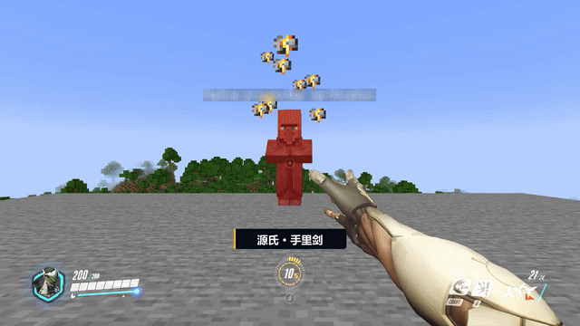

Full trailer link pending · <a href="docs/media/README.md">Media sources</a>

<table>
  <tr>
    <td width="50%" align="center">
      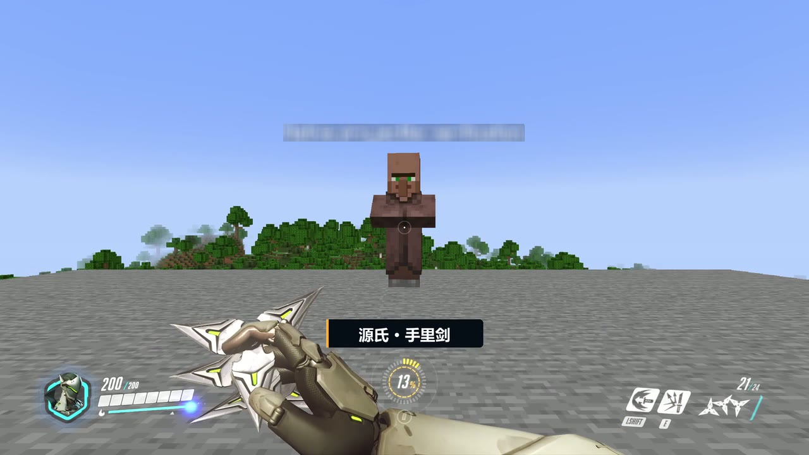 
      Genji · Shuriken and HUD
    </td>
    <td width="50%" align="center">
      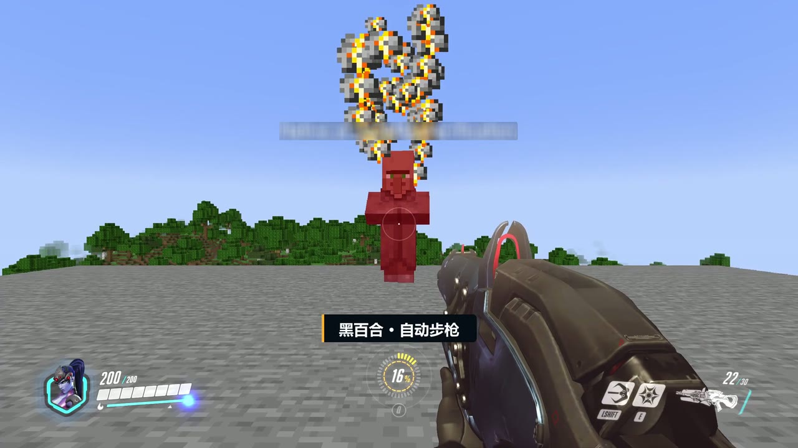 
      Widowmaker · Minecraft creatures
    </td>
  </tr>
  <tr>
    <td width="50%" align="center">
      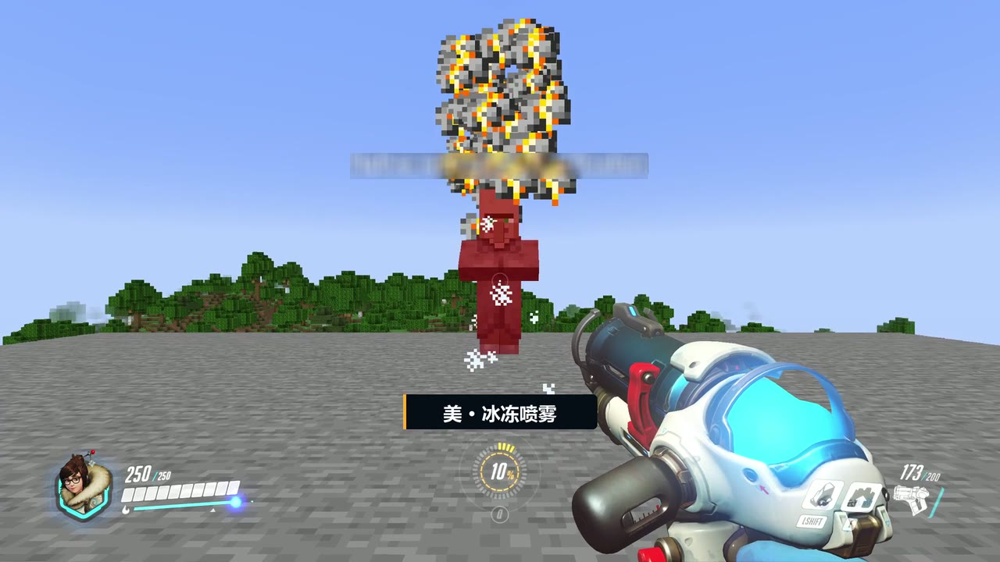 
      Mei · Freeze spray
    </td>
    <td width="50%" align="center">
      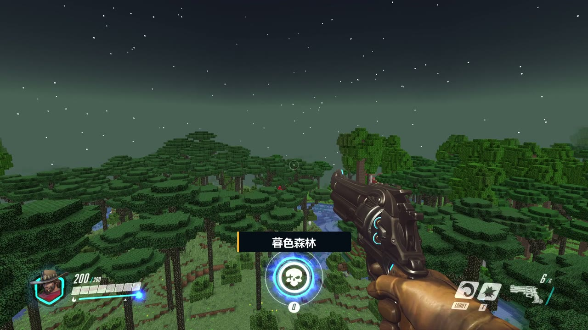 
      McCree · Twilight Forest
    </td>
  </tr>
</table>

## Features

<table>
  <tr>
    <td width="33%" valign="top">
      <strong>🎯 Original heroes</strong> 
      Play 14 heroes, including Roadhog and Winston, with original hands, weapon animations, HUD, and sound.
    </td>
    <td width="33%" valign="top">
      <strong>🌍 A real world</strong> 
      Explore terrain, creatures, and dimensions. Minecraft handles movement, collisions, and saves.
    </td>
    <td width="33%" valign="top">
      <strong>⚔️ Survival and training</strong> 
      Use F5 to summon hero training NPCs and toggle survival or invulnerability. Heroes and training NPCs take no fall damage.
    </td>
  </tr>
  <tr>
    <td width="33%" valign="top">
      <strong>🧭 World tools</strong> 
      Fly, set the time, build portals, summon mobs, reach boss areas, and refill ability resources.
    </td>
    <td width="33%" valign="top">
      <strong>🌲 Twilight Forest and shaders</strong> 
      Explore installed dimension mods and use optional Iris / MakeUp shaders.
    </td>
    <td width="33%" valign="top">
      <strong>🚀 One launcher</strong> 
      Double-click to reach the hero picker. Stopping the game saves the world.
    </td>
  </tr>
</table>

## Download

<!-- DOWNLOAD_LINKS -->
**OWMC v1.0.0 package (`OWMC-1.0.0.zip`, 5.46 GB).** Download link pending.

This download section is for the package rebuilt from current development, including the hero and survival updates.

Mirror pending · SHA256: `8b4069c050b40af85574fa1d0fb94c9e5a8009b6616946227e6f13cb3318c226`
<!-- /DOWNLOAD_LINKS -->

## Quick start

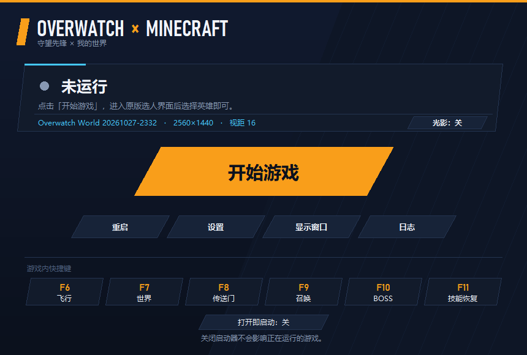

Once you have the complete package:

1. Extract the entire ZIP and double-click **`ow x mc 启动器.exe`**.
2. Wait for the hero picker, then select a hero. If “打开即启动” (start on opening) is off, click “开始游戏” (start game).
3. Click **“结束游戏”** (stop game) in the launcher and wait for the world to save.

Requirements: Windows 10 2004+ / Windows 11 x64, a GPU with Direct3D 11 and OpenGL support, at least 8 GB RAM (16 GB recommended), and about 20 GB free space. The package supplies its runtimes; no separate Python or Java installation is needed. Extract to NTFS / exFAT: the ZIP exceeds FAT32’s single-file limit.

See the [player guide (Chinese)](docs/PLAYER-README.md) for installation, runtime dependencies, logs, and troubleshooting.

## Controls

Keep the Overwatch window focused. Some laptops require `Fn` for function keys.

| Keys | Action | Keys | Action |
| --- | --- | --- | --- |
| WASD / mouse | Move / look | H | Return to the hero picker |
| Space / Ctrl | Jump; ascend / descend while flying | F5 | Hero summons / survival mode |
| Left / right mouse | Primary / secondary attack | F6 / F7 | Flight / world settings |
| R / V | Reload / melee | F8 / F9 | Portals / mob summons |
| Shift / E / Q | Hero abilities / ultimate | F10 / F11 | Boss destinations / ability resource refill |

Use number keys or the numeric keypad to select menu items. Follow the on-screen prompts to change pages or go back.

## Hero restoration progress

**14 heroes · 89 abilities and mechanics · ✅ 86 restored · 🚧 1 partial · ❌ 2 not restored**

The full kits of McCree, Mei, Torbjörn, Widowmaker, Roadhog, and Winston have been confirmed in game. Expand a hero to see controls and status. [Icon sources](docs/media/README.md#图标规格).

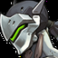 <strong>Genji</strong> · 8/8 restored

| Icon | Ability | Keys | Status |
| :---: | --- | --- | --- |
|  | Shuriken | LMB | ✅ Restored |
| 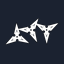 | Shuriken (Secondary Fire) | RMB | ✅ Restored |
|  | Swift Strike | Shift | ✅ Restored |
| 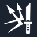 | Deflect | E | ✅ Restored |
| 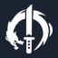 | Dragonblade | Q → LMB | ✅ Restored |
|  | Cyber-Agility (Double Jump) | Space → Space | ✅ Restored |
|  | Cyber-Agility (Wall Climb) | Face a wall: W + Space | ✅ Restored |
|  | Quick Melee | V | ✅ Restored |

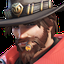 <strong>McCree</strong> · 6/6 restored

| Icon | Ability | Keys | Status |
| :---: | --- | --- | --- |
| 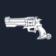 | Peacekeeper | LMB | ✅ Restored |
| 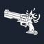 | Fan the Hammer | RMB | ✅ Restored |
|  | Combat Roll | W + Shift | ✅ Restored |
| 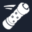 | Flashbang | E | ✅ Restored |
|  | Deadeye | Q → wait for lock-on → LMB | ✅ Restored |
|  | Quick Melee | V | ✅ Restored |

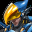 <strong>Pharah</strong> · 6/6 restored

| Icon | Ability | Keys | Status |
| :---: | --- | --- | --- |
| 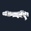 | Rocket Launcher | LMB | ✅ Restored |
|  | Jump Jet | Shift | ✅ Restored |
|  | Concussive Blast | E | ✅ Restored |
| 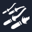 | Barrage | Q | ✅ Restored |
|  | Hover Jets | Hold Space in the air | ✅ Restored |
|  | Quick Melee | V | ✅ Restored |

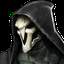 <strong>Reaper</strong> · 5/6 restored · 1 not restored

| Icon | Ability | Keys | Status |
| :---: | --- | --- | --- |
| 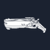 | Hellfire Shotguns | LMB | ✅ Restored |
|  | Wraith Form | Shift + W | ✅ Restored |
|  | Shadow Step | E → LMB to confirm | ✅ Restored |
|  | Death Blossom | Q | ❌ Not restored |
|  | The Reaping | Approach the soul after a kill | ✅ Restored · healing tested, victim head visuals await checks |
|  | Quick Melee | V | ✅ Restored |

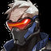 <strong>Soldier: 76</strong> · 6/6 restored

| Icon | Ability | Keys | Status |
| :---: | --- | --- | --- |
| 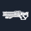 | Heavy Pulse Rifle | LMB | ✅ Restored |
|  | Helix Rockets | RMB | ✅ Restored |
|  | Sprint | W + Shift | ✅ Restored |
|  | Biotic Field | E | ✅ Restored |
|  | Tactical Visor | Q → LMB | ✅ Restored |
|  | Quick Melee | V | ✅ Restored |

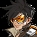 <strong>Tracer</strong> · 5/5 restored

| Icon | Ability | Keys | Status |
| :---: | --- | --- | --- |
| 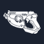 | Pulse Pistols | LMB | ✅ Restored |
|  | Blink | W + Shift | ✅ Restored |
|  | Recall | Move first → E | ✅ Restored |
|  | Pulse Bomb | Q | ✅ Restored |
|  | Quick Melee | V | ✅ Restored |

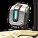 <strong>Bastion</strong> · 6/6 restored

| Icon | Ability | Keys | Status |
| :---: | --- | --- | --- |
| 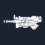 | Configuration: Recon | LMB in Recon mode | ✅ Restored |
|  | Reconfigure | Shift | ✅ Restored |
| 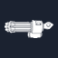 | Configuration: Sentry | Shift → LMB | ✅ Restored |
|  | Self-Repair | Hold E | ✅ Restored |
| 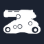 | Configuration: Tank | Q → LMB | ✅ Restored |
|  | Quick Melee | V | ✅ Restored |

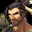 <strong>Hanzo</strong> · 6/6 restored

| Icon | Ability | Keys | Status |
| :---: | --- | --- | --- |
|  | Storm Bow | Hold LMB → release | ✅ Restored |
|  | Sonic Arrow | Shift → charge and release LMB | ✅ Restored |
|  | Scatter Arrow | E → charge and release LMB | ✅ Restored |
|  | Dragonstrike | Q | ✅ Restored |
|  | Wall Climb | Face a wall: W + Space | ✅ Restored |
|  | Quick Melee | V | ✅ Restored |

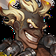 <strong>Junkrat</strong> · 5/7 restored · 1 partial · 1 not restored

| Icon | Ability | Keys | Status |
| :---: | --- | --- | --- |
| 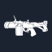 | Frag Launcher | LMB | ✅ Restored |
|  | Concussion Mine | Shift | ✅ Restored |
|  | Concussion Mine (Detonate) | Shift → RMB | ✅ Restored |
| 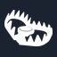 | Steel Trap | E | ✅ Restored |
|  | RIP-Tire (Driving) | Q → W; Space to climb walls | ❌ Not restored |
|  | Total Mayhem | Automatic on death | 🚧 Partial: visuals incomplete |
|  | Quick Melee | V | ✅ Restored |

 <strong>Mei</strong> · 6/6 restored

| Icon | Ability | Keys | Status |
| :---: | --- | --- | --- |
| 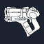 | Endothermic Blaster | Hold LMB | ✅ Restored |
|  | Endothermic Blaster (Icicle) | RMB | ✅ Restored |
|  | Cryo-Freeze | Shift | ✅ Restored |
|  | Ice Wall | E to preview, left click to place, E / right click to cancel | ✅ Restored |
|  | Blizzard | Q | ✅ Restored |
|  | Quick Melee | V | ✅ Restored |

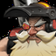 <strong>Torbjörn</strong> · 10/10 restored

| Icon | Ability | Keys | Status |
| :---: | --- | --- | --- |
| 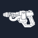 | Rivet Gun | 1 → LMB | ✅ Restored |
| 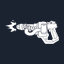 | Rivet Gun (Secondary Fire) | 1 → RMB | ✅ Restored |
| 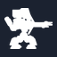 | Build Turret | Shift to preview, left click to place, right click to cancel | ✅ Restored |
|  | Armor Pack | E | ✅ Restored |
|  | Molten Core | Q | ✅ Restored |
| 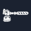 | Forge Hammer | 2 → LMB | ✅ Restored |
|  | Forge Hammer (Repair) | 2 → LMB on a damaged turret | ✅ Restored |
|  | Forge Hammer (Upgrade) | 2 → LMB on a level 1 turret | ✅ Restored |
|  | Scrap Collector | Approach scrap after a kill | ✅ Restored |
|  | Quick Melee | V | ✅ Restored |

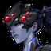 <strong>Widowmaker</strong> · 6/6 restored

| Icon | Ability | Keys | Status |
| :---: | --- | --- | --- |
|  | Widow’s Kiss (Automatic) | LMB | ✅ Restored |
| 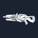 | Widow’s Kiss (Scoped) | Hold RMB → LMB | ✅ Restored |
|  | Grappling Hook | Shift to fire, Shift or Space to release early | ✅ Restored |
|  | Venom Mine | E | ✅ Restored |
|  | Infra-Sight | Q | ✅ Restored |
|  | Quick Melee | V | ✅ Restored |

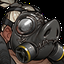 <strong>Roadhog</strong> · 6/6 restored

| Icon | Ability | Input | Status |
| :---: | --- | --- | --- |
|  | Scrap Gun | Left click | ✅ Restored |
| 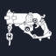 | Scrap Gun secondary fire | Right click | ✅ Restored |
|  | Chain Hook | Shift | ✅ Restored |
|  | Take a Breather | E | ✅ Restored |
|  | Whole Hog | Q | ✅ Restored |
|  | Quick Melee | V | ✅ Restored |

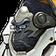 <strong>Winston</strong> · 5/5 restored

| Icon | Ability | Input | Status |
| :---: | --- | --- | --- |
| 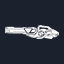 | Tesla Cannon | Hold left click | ✅ Restored |
|  | Jump Pack | Shift | ✅ Restored |
|  | Barrier Projector | E | ✅ Restored |
|  | Primal Rage | Q | ✅ Restored |
|  | Quick Melee | V | ✅ Restored |

## How it works and development

Both games run together. Overwatch receives input and renders the hero. Minecraft handles the world and combat results, then sends its world image back to the Overwatch window.

<strong>Build from source</strong>

Development requires Windows x64, Python 3.13, JDK 21, Gradle 8.10.2, and MinGW-w64. See the [build guide](docs/BUILDING.md), [two-process design](docs/PASSTHROUGH.md), and [documentation index](docs/README.md).

## Credits and license

Thanks to [Universal Modder](https://github.com/rehan-remade/universal-modder) for the [two-process approach](https://github.com/rehan-remade/universal-modder/tree/main/skills/mashup-mods), [Prometheus](https://github.com/saturn-xvi/prometheus) for offline-client research, and Fabric, Twilight Forest, Sodium, Iris, and the other open-source components. Developed with assistance from Claude / Codex.

Project-owned code is licensed under the [MIT License](LICENSE), copyright **2026 RPQ123**. Third-party code and assets retain their own licenses; see [third-party notices](THIRD_PARTY_NOTICES.md) and [component details](docs/THIRD-PARTY.md).
