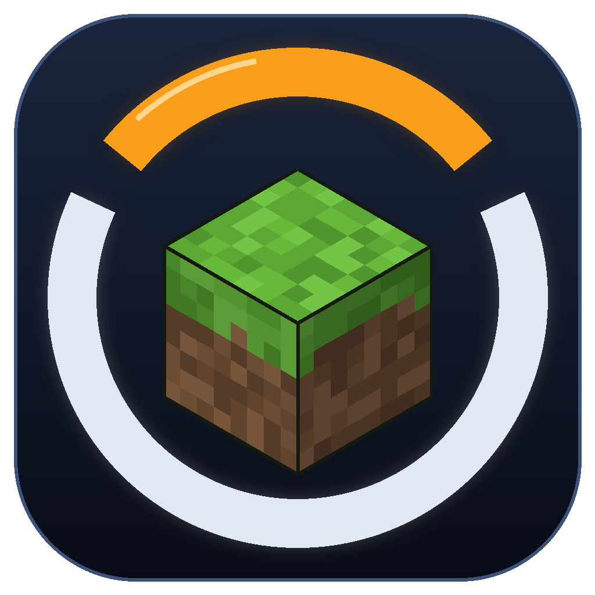
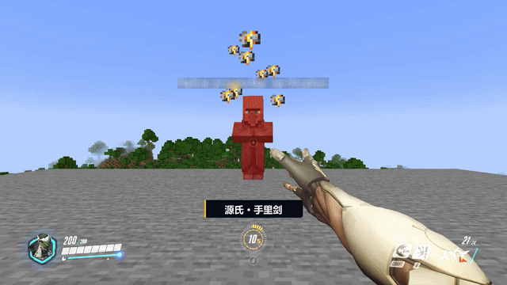
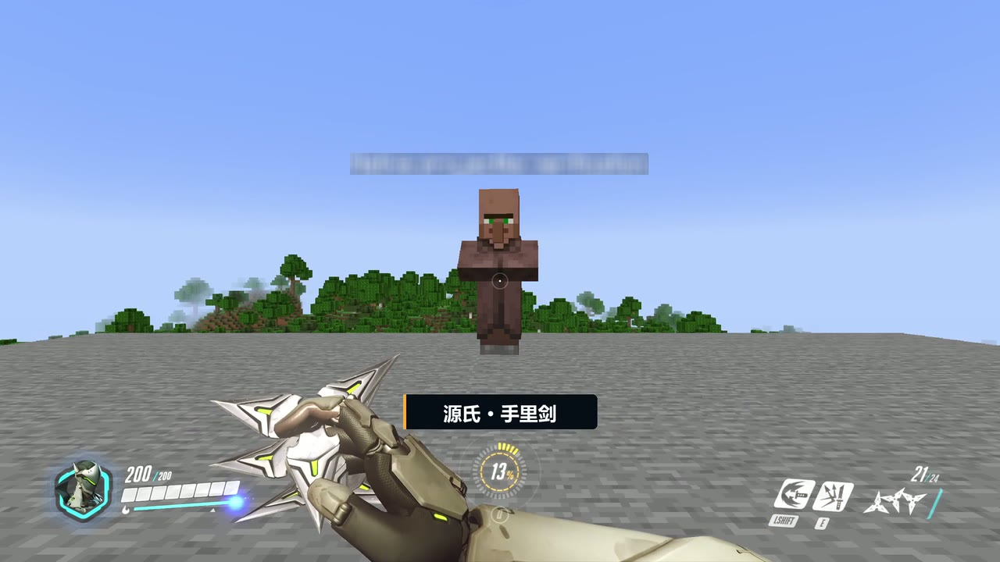
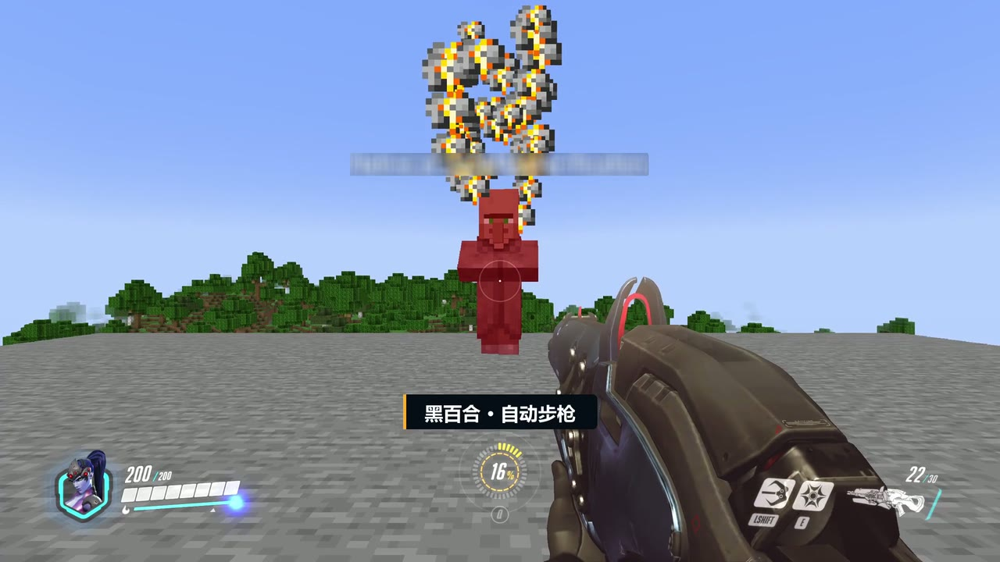
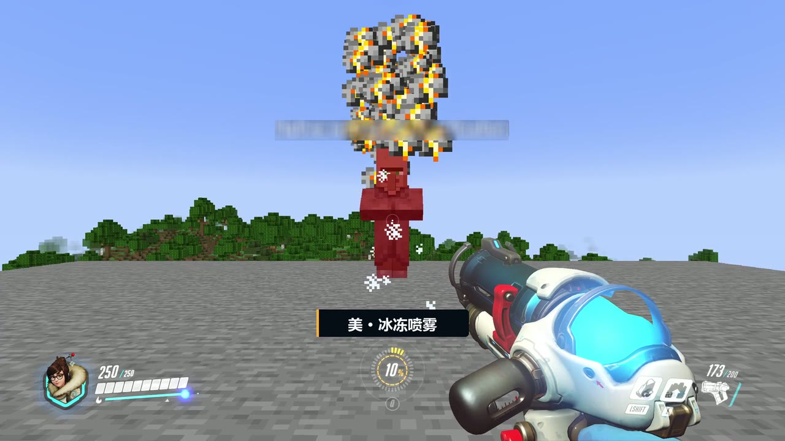
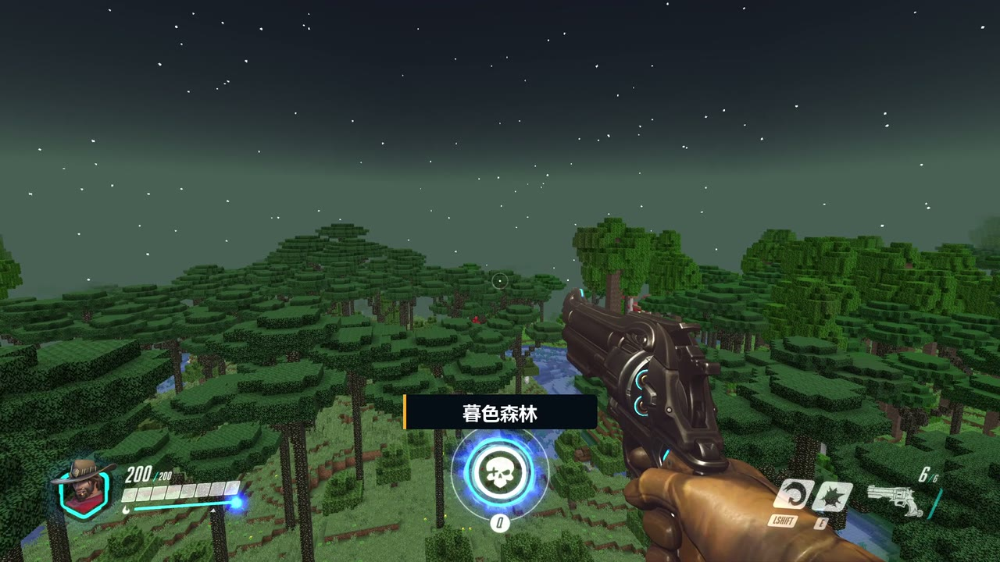
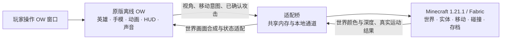

<div align="center">
  
  <h1>Overwatch × Minecraft</h1>
  <p><strong>用守望先锋的英雄，探索真正的 Minecraft 世界。</strong></p>
  <p>
    
    
    
    
    <a href="LICENSE"></a>
  </p>
  <p>简体中文 · <a href="README.en.md">English</a> · <a href="#下载">下载</a> · <a href="docs/PLAYER-README.md">玩家说明</a> · <a href="docs/BUILDING.md">开发构建</a></p>
</div>

两个真实游戏进程共同运行：**原版 OW 提供英雄、手模、武器动画、HUD 与声音，Minecraft 提供世界、移动、碰撞和存档。** 玩家在 OW 窗口中游玩，后台运行实际的 Minecraft 世界。

本项目使用 **2016 年守望先锋离线测试版 0.8.0.24919**，是非商业粉丝研究项目；与暴雪娱乐、Mojang、微软无关，未获其赞助或认可。**不出售、不商用。** 粉丝声明不代表已获得游戏客户端或提取素材的再分发授权。

## 演示

<p align="center">
  
</p>

**宣传片：（链接待补）**。上方 GIF 从现有实机成片提取，12 位英雄快切，8.4 秒、约 6.26 MB，无音轨；完整视频不放进源码仓库。

| 原版英雄与手模 | Minecraft 世界与效果 |
| --- | --- |
|  |  |
|  |  |

画面记录当时通过审查的玩法切片，不能代替所有英雄、技能和持续游玩的完整验收。[素材来源与时间点](docs/media/README.md)。

## 特性

- **双进程融合**：保留原版 OW 英雄表现，Minecraft 1.21.1 / Fabric 负责真实地形、实体、移动、方块碰撞、维度和世界保存。
- **12 位输出 / 防御英雄**：源氏、麦克雷、法老之鹰、死神、士兵：76、猎空、堡垒、半藏、狂鼠、小美、托比昂、黑百合。原生武器、动画、HUD 和已接入的攻击事件共同作用于 MC 世界；完整技能覆盖仍有缺项。
- **原版声音**：保留武器原声，并接入原版选人、技能语音；语音、模型等私有资源由本地环境提供，不随源码仓库分发。
- **F5 英雄召唤与生存模式**：当前源码可召唤单个或全部 12 位英雄训练 NPC、清理自己的召唤，并切换生存 / 无敌模式。训练 NPC 是 MC 实体，其行为不等同于完整 OW 英雄 AI。
- **F6–F11 工具菜单**：飞行、世界时间与夜视、传送门、怪物召唤、Boss 入口、实验辅助补给。
- **暮色森林与可选光影**：已有真实暮色森林维度演示；Iris / MakeUp 光影是可选配置，能否使用取决于实际安装的模组和显卡。
- **一键启动整合包**：统一启动器协调两个进程，正常结束时保存世界并恢复原生适配状态。

### 开发版已实现，整合包下个版本加入

- **F5 英雄召唤 / 生存模式**：已在开发版源码实现；现存 `OWMC-1.0.0` 整合包尚未包含对应功能类。
- **小美冰墙修复**：已在开发版完成；将在下个整合包版本加入，旧宣传片没有补录修复后的镜头。

以上更新需同步重打包并完成正常启动与功能验收后再提供下载；本次公开快照检查没有启动游戏复测。

## 下载

<!-- DOWNLOAD_LINKS -->
> **整合包 OWMC-1.0.0（约 5GB）下载链接：待补**
>
> 备用下载链接：待补 · SHA256 校验文件：待补
>
> 目前仅有本地测试包；下载入口将在版本同步、公开前审计和分发范围确认后填写。
<!-- /DOWNLOAD_LINKS -->

GitHub 源码仓库不包含 OW / Minecraft 客户端、私有模型、语音、贴图、世界存档、工具链或整合包。克隆仓库不能直接获得完整游戏环境。

## 快速开始

取得完整整合包后：

1. **完整解压** `OWMC-1.0.0.zip`，进入解压后的文件夹。
2. **双击 `ow x mc 启动器.exe`**，等待启动器按默认设置自动加载后台 MC 世界并进入原版英雄选择界面。
3. 选择英雄后游玩；退出时在启动器点击 **“结束游戏”**，等待正常存档和恢复完成。

若之前关闭过“打开即启动”，在启动器主页点击“开始游戏”即可。完整包自带运行时，玩家无需安装 Python、Java 或编译器。不要在压缩包预览窗口中启动；ZIP 超过 4 GB，请使用 NTFS / exFAT 磁盘。

**系统要求：** 64 位 Windows 10 2004+ / Windows 11；显卡与驱动支持 Direct3D 11 及 Minecraft 1.21.1 所需 OpenGL；至少 8 GB 内存、建议 16 GB；建议预留 20 GB 磁盘空间。普通用户权限运行，三个程序保持同一用户和权限级别。

**安全软件提示：** 未签名启动器、原版离线客户端及进程内适配 DLL 可能被拦截。这不能直接证明恶意软件或误报；先核对来源、SHA256 和具体检测记录，仅对信任的副本按记录处理。详见[玩家说明中的杀毒软件与运行库说明](docs/PLAYER-README.md#defender--杀毒软件拦截)。

本机已有三次新目录一键启动验收；其他电脑、显示驱动和长时间游玩仍待验证。

## 按键

先让 OW 窗口获得焦点；笔记本可能需要配合 `Fn`。

| 按键 | 功能 |
| --- | --- |
| WASD / 鼠标 | 移动 / 转向 |
| 空格 / Ctrl | 跳跃；飞行时上升 / 下降 |
| 鼠标左键 / 右键 | 英雄主攻击 / 次攻击（若有） |
| R / V | 装弹 / 近战，依英雄而定 |
| Shift / E / Q | 原版技能 / 终极技能，受原版阶段与充能条件限制 |
| H | 返回原版英雄选择界面 |
| **F5** | 英雄召唤 / 生存模式菜单；当前源码功能，待同步整包 |
| F6 | 飞行开关，可在启动器设置中改键 |
| F7 | 世界设置：时间、固定白天、夜视等 |
| F8 | 传送门菜单 |
| F9 | 怪物召唤菜单 |
| F10 | Boss 入口菜单 |
| F11 | 实验辅助补给：大招充能与已接入的冷却恢复 |

菜单使用主键盘或小键盘数字选择；分页与返回方式以屏幕提示为准。F5 根菜单为 `1` 单个英雄、`2` 全部英雄、`3` 清理本人召唤、`4` 切换生存。菜单项受存活、模式、当前世界和实际安装模组限制，F11 不保证恢复所有多充能或燃料资源。

## 工作原理



攻击桥接使用已认证的原生事件，MC 服务端负责实际命中与世界效果。截图、夹具通过、后台进程存在分别能证明不同事情，不能互相替代。详见[双进程协议与演进记录](docs/PASSTHROUGH.md)和[可玩目标验收门槛](docs/PLAYABLE-GOAL.md)；历史文档中的旧 PID 和旧状态以[最新接续记录](docs/TAKEOVER.md)为准。

## 已知问题

以下基于宣传片复制包的实机抽查，描述当次没有获得认证结果的项目；本轮仅做文档与素材整理，没有重新启动游戏复测。

| 英雄 / 项目 | 目前可确认的限制 |
| --- | --- |
| 麦克雷 · 神射手（Q） | 未获得合格演示画面，完整表现待复核。 |
| 死神 · 死亡绽放（Q） | 满充能后实测仍没有认证的技能开始事件。 |
| 狂鼠 · 炸弹轮胎 | 驾驶与移动未认证，引爆提交未接通；不能据此承诺轮胎爆炸可用。 |
| 狂鼠 · 垂死挣扎 | 曾有死亡、炸弹与爆炸计数变化，但画面取证未通过，未收入演示。 |
| 托比昂 · 铆钉枪主 / 次攻击、锻造锤、炮台修理 / 升级 | 当次原生输入复测没有取得对应认证事件。 |
| 整体运行 | 跨机器启动、全英雄完整技能、所有 Boss 全程战斗及持续性能尚未完成验收；远程桌面和显示模式切换仍可能影响启动。 |

小美冰墙已在开发版修复，整合包下个版本加入；旧片中的冰墙阻塞记录保留为历史。F5 / 生存已在当前源码实现，但未出现在这段宣传片或现存旧整包中。英雄逐项状态见[英雄验收表](docs/HERO-MATRIX.md)，其中历史日期与覆盖范围需要一并阅读。

## 开发者构建

开发环境为 **Windows x64、Python 3.13、JDK 21、Gradle 8.10.2 和 MinGW-w64**。客户端、工具链与私有资源需要自行准备，源码仓库不携带这些文件。

```powershell
# 在仓库根目录；初始化依赖需要 uv 和网络。
.\tools\setup_environment.ps1
.\.venv\Scripts\python.exe tools/check_environment.py

# Minecraft guest：Gradle build + check，不启动游戏。
.\tools\build_guest.ps1 -Tasks build,check

# native-host 合成器；统一调用 resolve_native_compiler.ps1。
.\tools\build_live_passthrough.ps1

# HTTP 契约入口会自行启动 Java fixture。
.\.venv\Scripts\python.exe bridge/test_contract.py
```

六个原生模块、运行时准备与 `tools/modpack/build.py --public` 的完整示例见[构建说明](docs/BUILDING.md)。`--public` 只控制打包器的客户端 / 私有资源排除范围，不代表许可证、干净机器运行或可公开分发已获确认。

| 目录 | 用途 |
| --- | --- |
| `guest/` | Fabric guest、世界输出、运动与战斗适配、菜单 |
| `native-host/` | 原版进程观察、画面合成和状态适配 |
| `bridge/` | Python 通道与契约测试 |
| `tools/` / `launchers/` | 启动器、构建、环境检查与正常停止工具 |
| `assets/launcher/` / `docs/media/` | 项目 logo 与压缩演示素材 |
| `docs/` | 架构、玩家和开发说明；[文档索引](docs/README.md) |
| `research/` / `data/` / `dist/` | 本机研究、生成数据和整合包，保持忽略 |

## FAQ

**这是 Minecraft 里重做的 OW 武器包吗？** 原版离线 OW 和 MC 同时运行。玩家英雄的手模、动画与 HUD 由原版 OW 绘制；MC 提供实际世界。

**能联网，或者连接现行正式服吗？** 当前范围是指定离线测试版与本地单人世界，不提供官方联机、账号登录或正式服兼容支持。

**为什么没有下载链接，或者 F5 没反应？** 下载尚未公开；F5 / 生存属于当前源码的后续更新，现存旧 `1.0.0` 快照未同步。发布前须更新整包并重新验收，不能用旧包验证新菜单。

**启动后黑屏、只有一个窗口或一直加载？** 用启动器正常结束后保留中文错误与日志；检查完整解压、文件隔离和显示模式。[玩家说明](docs/PLAYER-README.md)提供运行库、日志位置、备份和停止步骤。

**缺少暮色森林、某个 Boss 或光影入口？** 以当前档案实际安装的模组为准。不同实验档案的依赖与存档不能直接混用。

## 致谢 / 引用

- [Universal Modder](https://github.com/rehan-remade/universal-modder)（MIT）及 [mashup-mods skill](https://github.com/rehan-remade/universal-modder/tree/main/skills/mashup-mods)：跨游戏双进程路线与工具方法参考。
- [Prometheus](https://github.com/saturn-xvi/prometheus)（AGPL-3.0，见上游）：原版离线客户端研究、加载与结构参考；其授权范围单独保留。
- [Fabric Loader](https://github.com/FabricMC/fabric-loader) / [Fabric API](https://github.com/FabricMC/fabric-api)（Apache-2.0）、[暮色森林 Fabric](https://github.com/TeamTwilight/twilightforest-fabric)（LGPL-2.1-or-later）、[owo-lib](https://github.com/wisp-forest/owo-lib)（MIT）。
- [Sodium](https://github.com/CaffeineMC/sodium)（所用 0.8.13 为 PolyForm Shield 1.0.0）、[Iris](https://github.com/IrisShaders/Iris)（所用构建为 LGPL-3.0-only）、[MakeUp Ultra Fast](https://github.com/javiergcim/MakeUpUltraFast)（LGPL-3.0）：渲染与可选光影组件，按各自许可证处理。
- [Dear ImGui](https://github.com/ocornut/imgui)（MIT）：Prometheus 上游界面组件；本仓库未内置其源码。[JNA](https://github.com/java-native-access/jna)（Apache-2.0 或 LGPL-2.1-or-later）、[Mixin](https://github.com/SpongePowered/Mixin)（MIT）及 Python / Java 生态组件。

项目由 Claude / Codex 辅助开发。组件的实际用途、版本与许可来源见[第三方说明](docs/THIRD-PARTY.md)；列在致谢中不代表该组件或游戏资源已获任意再分发许可。

## 许可证与资源边界

本项目自有代码采用 [MIT License](LICENSE)，版权归 **2026 RPQ123**。第三方代码、依赖和资源继续适用各自许可；MIT 不覆盖 Prometheus 的 AGPL 代码或其他第三方作品。详见 [THIRD_PARTY_NOTICES.md](THIRD_PARTY_NOTICES.md)。

OW / Minecraft 的客户端、模型、语音、贴图等游戏资源不在源码仓库中，也不在 MIT 许可证的授权范围内。`docs/media/` 只保留演示截图与短 GIF。游戏、商标及第三方作品的权利归各自权利人；完整整合包的分发范围需另外确认。
